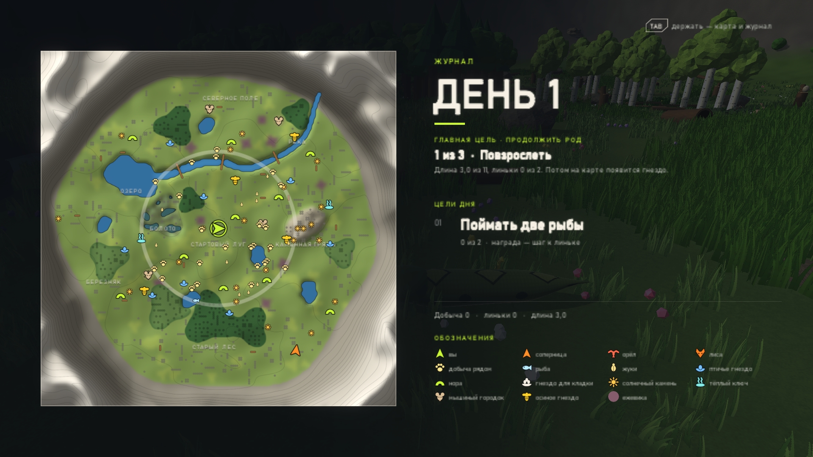
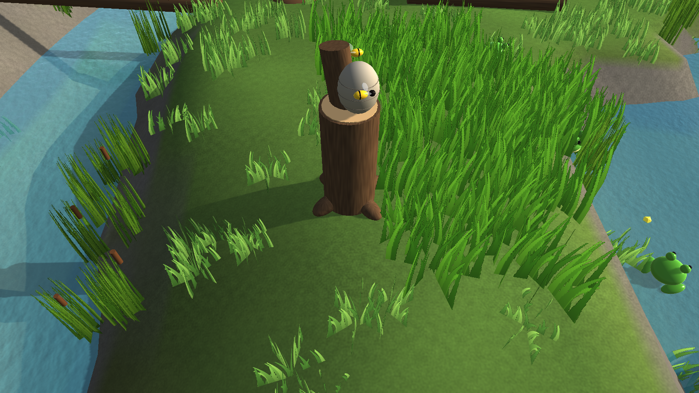
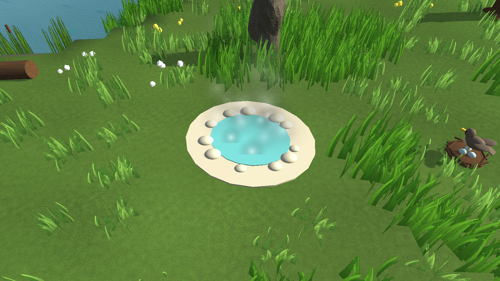
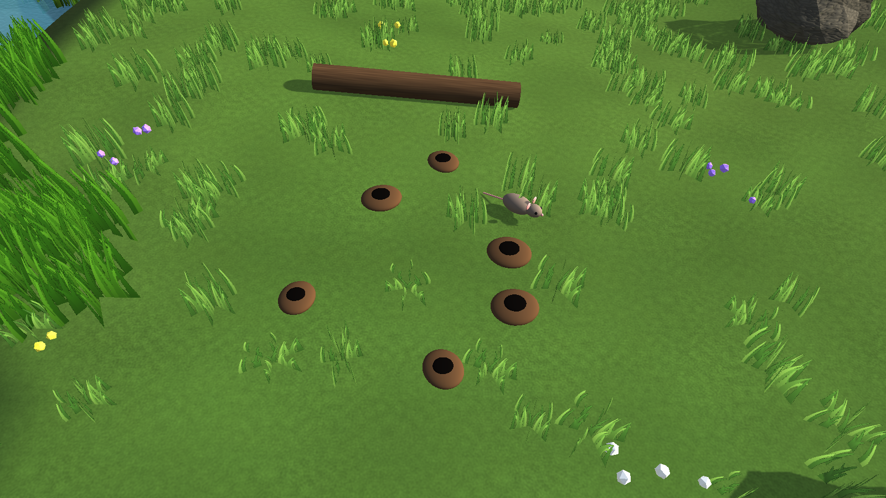
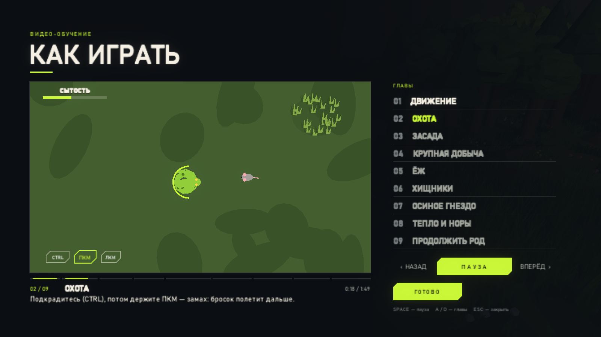
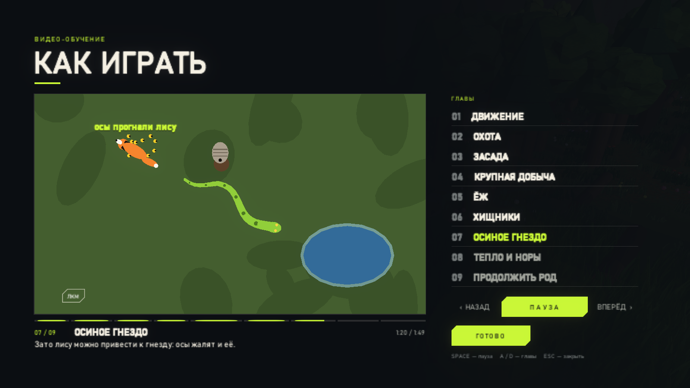

<div align="center">

# 🐍 W I L D &nbsp; S N A K E

### *Выживи. Повзрослей. Продолжи род.*

Симулятор выживания змеи от третьего лица — охота из засады, хищники, змея-соперница, день и ночь,<br>
линька с улучшениями и главная цель: отложить кладку и вырастить следующее поколение.

<br>


<br>



<sub>Карта и журнал (Tab): регионы, норы, тёплые ключи, мышиные городки, осиные гнёзда и цели дня</sub>

</div>

---

## ✦ Об игре

Вы — молодая змея на лугу, окружённом кольцом гор. Здесь всё хочет есть: вы — мышей и лягушек, орёл — вас.
Голод не ждёт, ночь холодит кровь, а лиса идёт по вашему следу.

> **Цель — продолжить род.** Вырастите, переживите две линьки, ночью сытой отложите яйца в гнезде
> и охраняйте кладку, пока не вылупятся змеёныши. Дальше — играете следующим поколением.

Весь мир — **ни одного стороннего ассета**: модели, текстуры, меши, интерфейс, музыка и звуки
созданы кодом прямо в проекте.

---

## ✦ Что внутри

<table>
<tr>
<td width="50%" valign="top">

### 🎯 Охота
- **Бросок и замах** — ЛКМ кусает, ПКМ копит силу для дальнего броска
- **Засада** — замрите, и змея сольётся с травой; кончик хвоста подманивает добычу
- **Обвивание** — кролика мало схватить, его нужно задушить (F)
- **Нюх** — язык чует добычу далеко за кустами
- 7 видов добычи: жук, мышь, лягушка, птица, кролик, ёж, рыба

</td>
<td width="50%" valign="top">

### ⚠️ Опасности
- **Орёл** днём кружит и пикирует — спасают трава, кроны, полые брёвна (в них — только через дыру)
- **Лиса** ночью идёт по следу и таскает яйца из кладки
- **Шипение (Q)** отгоняет лису, а **«мёртвая змея» (X)** заставляет хищника потерять интерес
- **Осиные гнёзда** злятся от шума — рой гонит до воды или норы… и жалит лису
- **Голод и холод** — змея холоднокровна, замёрзнув, она слабеет

</td>
</tr>
<tr>
<td width="50%" valign="top">

### 🦔 Ёж — отдельная головоломка
Заметив вас, он сворачивается в колючий шар. Укус — и вы ранены. Но шар можно
**катить носом в воду**, где ёж беззащитен, или подкараулить миг, когда он
**выглядывает**.

</td>
<td width="50%" valign="top">

### 🧬 Рост и род
- **Линька** — каждые несколько добыч новая кожа и улучшение на выбор (13 видов по 3 уровня, у сильных — своя цена; все взятые — `U`)
- **Цели дня** — поймать рыбу, уйти от орла, задушить кролика…
- **Норы** — сохранение и быстрая ночь
- **Поколения** — вылупившиеся змеёныши продолжают историю

</td>
</tr>
<tr>
<td colspan="2" valign="top">

### 🐍 Соперница
Вторая змея под управлением ИИ — не декорация, а соперник. Днём идёт **охотничье состязание**: в углу экрана
счёт «вы 3 : 2 она», а итог на закате дарит победительнице рост. Раз в день появляется **трофей дня** — золотая
добыча, за которой охотитесь вы обе. Пока вы душите кролика, она **приползёт его отбить** — шипите.
Укусите её — **затаит обиду** и начнёт охоту на вас; победите — она вернётся, но не с нуля.

</td>
</tr>
</table>

---

## ✦ Мир, спроектированный вручную

Карта не случайна: её план лежит в [`WorldBlueprint.cs`](Assets/Scripts/WorldBlueprint.cs), сид отвечает только за мелочи.

| Регион | Характер |
|---|---|
| 🌾 **Стартовый луг** | безопасно: нора, рощица от орла, первые жуки и мыши |
| 🌊 **Река и озеро** | рубеж мира — три моста, брод вплавь или долгий обход |
| 🥚 **Северное поле** | гнездо для кладки, а рядом нора, тёплый ключ, мыши и ежевика-убежище |
| 🪨 **Каменная гряда** | солнечные камни, но открыто — земля орла |
| 🌲 **Старый лес** | густые кроны, птичьи гнёзда по опушкам, ночью — лиса |
| 🐸 **Болото и березняк** | лягушки, рыба, тёплый ключ на краю |

Между укрытиями тянутся **тропы высокой травы**: тихий путь длиннее, открытая прямая быстрее, но под небом.

<div align="center">
  

<sub>Осиное гнездо на старом пне · тёплый ключ · мышиный городок</sub>
</div>

---

## ✦ Видео-обучение

Не стена текста, а ролик: десять глав, где змейка сама показывает каждую механику — с подсвеченными
клавишами, субтитрами, таймлайном и перемоткой. *Справочник → «Смотреть»*. А в игре первые несколько раз
всплывают короткие подсказки с клавишей — ровно тогда, когда действие возможно.

<div align="center">
 
</div>

---

## ✦ Управление

<div align="center">

| Клавиша | Действие | | Клавиша | Действие |
|:---:|---|---|:---:|---|
| `W A S D` | ползти | | `F` | обвить добычу |
| `Мышь` | камера | | `E` | нюх · нора · кладка |
| `Ctrl` | красться | | `Space` | прыжок |
| `Shift` | быстрее | | `Tab` | карта и журнал |
| `U` | улучшения | | | |
| `ЛКМ` | бросок | | `H` | скрыть интерфейс |
| `ПКМ` | замах | | `Esc` | пауза |
| `Q` | шипение | | `X` (держать) | притвориться мёртвой |

</div>

Геймпад поддерживается.

---

## ✦ Запуск из исходников

> [!IMPORTANT]
> Сцена **не хранится в репозитории** — её целиком строит код (файл весит больше лимита GitHub).
> После клонирования её нужно собрать один раз.

1. Установите **Unity 6000.6.5f1** (через Unity Hub).
2. Откройте папку проекта в Unity.
3. Меню **`Tools → Build Snake Scene`** — соберёт сцену, материалы, интерфейс и сохранит `Assets/Scenes/WildSnake.unity`.
4. Откройте сцену и нажмите ▶.

Сборка игры: **`Tools → Build Game (Windows)`** → результат в `Builds/`.

<details>
<summary><b>Из командной строки</b></summary>

```bash
Unity -batchmode -nographics -quit -projectPath . -executeMethod SnakeSceneBuilder.Build
Unity -batchmode -nographics -quit -projectPath . -executeMethod GameBuilder.BuildWindows
```

Тесты:

```bash
Unity -batchmode -projectPath . -runTests -testPlatform EditMode -testResults results.xml
```
</details>

---

## ✦ Под капотом

```
Assets/
├─ Scripts/   игровая логика — GameManager, SnakeController, GridManager, WorldBlueprint, …
├─ Editor/    сборка сцены кодом: SnakeSceneBuilder, UIBuilder, EnvironmentBuilder
└─ Tests/     EditMode и PlayMode тесты (Unity Test Framework)
```

- **Логика в данных, Transform только показывает** — поле, добыча и хищники считаются в чистых данных.
- **Без аллокаций в кадре** — пулы вместо `Instantiate`, буферы выделены заранее.
- **Звук и музыка синтезируются** в фоновом потоке — ни одного аудиофайла.
- **Видео-обучение** рисуется фигурами прямо в меш UI — каждый кадр это функция времени, поэтому перемотка бесплатна.
- **130+ тестов** охраняют баланс, генерацию мира и замысел карты.

---

<div align="center">

<sub>Сделано с любовью к змеям 🐍 · Unity 6 · URP</sub>

</div>
